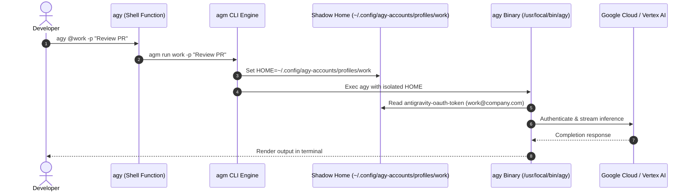

# Antigravity Multi-Account Manager: Architecture Deep Dive

This document explains the internal runtime architecture of Google Antigravity CLI (`agy`), why native multi-account execution fails, and how **`agm` (Antigravity Account Manager)** implements zero-collision simultaneous session isolation.

---

## 1. Antigravity CLI Runtime Architecture

The Antigravity CLI (`/usr/local/bin/agy`) is an AI-first terminal development agent written in Go (`google3/third_party/jetski`).

### Directory Discovery & State Storage
By default, the CLI discovers the user's home directory via `os.UserHomeDir()` (evaluating the `$HOME` environment variable on POSIX systems). It then anchors all persistence state under:

```text
~/.gemini/antigravity-cli/
├── antigravity-oauth-token       # Active OAuth2 consumer credentials & ID token JWT
├── settings.json                 # Global model preferences, permission policies
├── conversation_summaries.db     # SQLite database for indexing active trajectories
├── conversation_summaries.db-wal # SQLite write-ahead log
├── history.jsonl                 # CLI prompt history
├── installation_id               # Unique telemetry installation ID
├── brain/                        # Conversation trajectory logs and artifacts
├── cache/                        # Cached project mappings and skill discovery indices
└── presence/                     # Active agent presence state
```

---

## 2. The Multi-Account Concurrency Problem

When a developer attempts to authenticate a second Google account or run two Antigravity instances concurrently, several collisions occur:

1. **OAuth Token Overwriting**: `antigravity-oauth-token` is a single JSON file. Logging into account B overwrites account A's token. Any ongoing background subagents or sessions using account A instantly fail or silently switch identities.
2. **SQLite Database Locking**: `conversation_summaries.db` uses SQLite WAL mode. Two simultaneous `agy` processes concurrently writing to the same database file trigger `database is locked (5)` or `busy_timeout` race conditions.
3. **Trajectory & Context Bleed**: Artifacts, scratch files, and trajectory step indices collide within `brain/`, causing hallucinations or corrupted state between disparate projects.

---

## 3. The Shadow Home Isolation Solution

`agm` solves these issues by creating a **Shadow Home** environment for every configured Google account profile:

```text
~/.config/agy-accounts/profiles/<profile_name>/
├── .gemini/
│   ├── antigravity-cli/          # PRIVATE: Token, SQLite DB, history, brain
│   │   ├── antigravity-oauth-token
│   │   ├── settings.json
│   │   └── conversation_summaries.db
│   └── config/                   # SYMLINK: Shared MCP servers, rules, projects
├── .gitconfig                    # SYMLINK -> Real ~/.gitconfig
├── .ssh/                         # SYMLINK -> Real ~/.ssh
├── .bashrc                       # SYMLINK -> Real ~/.bashrc
├── .cargo/                       # SYMLINK -> Real ~/.cargo
├── .local/                       # SYMLINK -> Real ~/.local
└── .config/                      # SELECTIVE SYMLINK: gh, git, code configs
```

### Why This Achieves 100% Concurrency:
1. **Zero Database Locking**: Each profile maintains its own independent SQLite database. Five different terminals can run five different accounts at the exact microsecond without lock contention.
2. **Preserved Developer Identity**:
   - `git commit` commands executed by the agent read the symlinked `~/.gitconfig` and retain your correct developer author name and email.
   - `ssh` operations authenticate using your real `~/.ssh/` keys.
   - GitHub CLI (`gh`) credentials in `~/.config/gh` remain fully authenticated.
3. **Project File Independence**: Antigravity agents operate on absolute project paths (e.g., `/home/roshzen/Projects/my-app`), which are unaffected by the isolated shadow home.

---

## 4. Execution Dispatch Flow



---

## 5. Security & Token Hygiene

- **File Permissions**: All imported and generated `antigravity-oauth-token` credential files are explicitly created with `0600` (`-rw-------`) permissions, accessible exclusively by the local user.
- **Exclusion from Source Control**: The repository strictly ignores all token files, secrets, and profile directories via `.gitignore`.
- **JWT Verification**: `agm` inspects only the public header and payload portions of ID tokens to display email identity without transmitting tokens or relying on external untrusted libraries.
